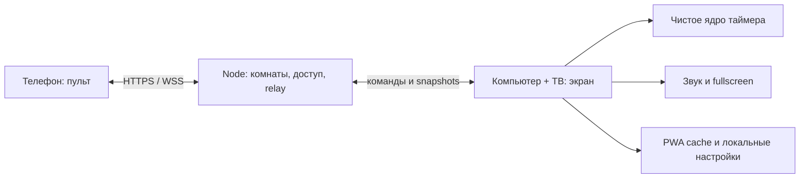

> Статус реализации 22.10.2026: src/timer, src/ui, src/platform и локальный PWA созданы. Разделы про remote/relay описывают следующий этап, не работающие функции. Подробная проверка — [отчёт](implementation-2026-10-22.md).

# Архитектура: факт и предложение

## Сейчас

В активном корне находятся локальный runtime src, сборка/проверки, документация, OpenSpec, tooling и макеты. Relay пока отсутствует. Незавершённый TypeScript scaffold и прежняя JS-реализация находятся в [архиве](../archive/README.md). Аудит описывает состояние до переноса.

## Согласованное направление пилота

Экран владеет активной тренировкой и окончательно принимает команды. Телефон отправляет намерения и показывает подтверждённое состояние. Сервер проверяет право на комнату, маршрутизирует сообщения и ограничивает нагрузку. Отсчёт не зависит от сети и сервера.

Потеря телефона, WAN или relay не останавливает работающий экран. Потеря самого компьютера — другой случай: на телефоне блокируются команды, новая независимая тренировка автоматически не запускается. Это предотвращает две расходящиеся версии одного занятия.

## Принятый владельцем стек и причины

| Компонент | Предложение | Обоснование и пределы |
| --- | --- | --- |
| Runtime | Node 24 LTS | Поддерживаемая LTS-ветка на дату исследования; текущая машина 22.23.2 годится для OpenSpec |
| UI | TypeScript + React + Vite | Два разных интерфейса с общими состояниями и компонентами; небольшая SPA без SSR |
| Стили | Tailwind 4 + CSS variables/tokens | Упрощает адаптивность и единообразие; не решает UX сам по себе |
| Домен | Чистые TS-функции + конечные состояния | Тестирование времени без DOM, React, сокетов и таймеров ОС |
| Сеть | Node + ws, один процесс для пилота | Изолированные комнаты и строгая схема сообщений; Express допустим для HTTP endpoints, не обязательная архитектурная зависимость |
| Хранение | Локальные настройки; ephemeral sessions и JSON-журналы | Аккаунты и серверная библиотека программ не входят; сводки по SSH в tools/ |
| Проверки | Vitest + Playwright | Детерминированная проверка времени и многоконтекстные сценарии экран/телефон |
| Доставка | Статические assets + Node relay за HTTPS reverse proxy | Health checks, один управляемый сервис, отдельный staging; конкретный хостинг ещё не выбран |

Точные версии React/Vite/TypeScript/ws и PWA-инструмента закрепить при bootstrap после проверки совместимости и npm metadata. Не использовать плавающий `latest` в воспроизводимой сборке. Tailwind 3.4 уже был в старом package.json; обновление — осознанная миграция, а не «добавление отсутствующего Tailwind».

Tailwind 4 требует современных CSS-возможностей: Safari 16.4+, Chrome 111+, Firefox 128+. Поэтому старое обещание Safari 14/Chrome 90 отменяется. Для пилота тестировать текущие стабильные Chrome/Edge на компьютере, Safari на iPhone и Chrome на Android; точные версии фиксировать в отчёте испытаний. Самостоятельные браузеры ТВ пока не поддерживаются. [Tailwind compatibility](https://tailwindcss.com/docs/compatibility), [upgrade guide](https://tailwindcss.com/docs/upgrade-guide). Node рекомендует для production Active/Maintenance LTS: [releases](https://nodejs.org/en/about/previous-releases).

React — рекомендуемый выбор, не prerequisite точного таймера. Vanilla TS тоже достаточен, но потребует вручную поддерживать обновления двух UI. Next.js/SSR, микросервисы, универсальная DI-система, наследование каждого таймера и отдельный state-management framework пока не обоснованы.

## Время и состояние

Один state machine: `idle → preparing → running ↔ paused → completed`. Изменение программы допустимо в idle; сброс во время занятия требует подтверждения. Часы настенного времени не участвуют в расчёте продолжительности.

Источник времени инъецируется в ядро. Интервал/animation frame просит обновить отображение, но не выполняет `remaining -= 1`. По прошедшему времени вычисляется текущая фаза и остаток; пропущенные callbacks не накапливают ошибку. Границы: ceil для оставшихся секунд, floor для прошедших, без отрицательного отображения. Пауза сохраняет накопленное время; resumed anchor создаётся заново.

`performance.now()` применим для монотонного времени текущего документа. Не обещать точность во время sleep компьютера или выгрузки вкладки: поведение системных часов и suspension различается. Цель проверки — активный видимый экран на бодрствующем компьютере или телефоне; фоновый будильник не обещается. На возврате из фона состояние пересчитывается; пропущенные звуки не воспроизводятся очередью. Reload/повторное открытие компьютера по решению владельца возвращает idle, сбрасывает активную тренировку и создаёт новую сессию. Последние параметры можно сохранить, active snapshot для продолжения — нельзя. Reload телефона-пульта только переподключает его действующее право. Самостоятельный мобильный таймер использует то же локальное ядро: его reload возвращает idle (предлагаемое единое правило).

## Контракт remote

Сообщение содержит protocolVersion, roomId, sessionEpoch, controlEpoch, commandId, expectedRevision, type и строго проверенный payload. Сервер проверяет полномочия; экран проверяет epoch/revision, последовательно выполняет команды и увеличивает control revision. Естественная смена фазы тоже повышает revision, UI ticks — нет; snapshots дополнительно имеют sequence, чтобы два снимка одной revision не приходили в обратном порядке. Повтор commandId не повторяет действие. Команды `configure`, `start`, `pause`, `resume`, `finish`, `reset` явные: сетевой `toggle` запрещён из-за неоднозначного повтора.

ACK означает принятие экраном, не простую доставку серверу. У телефона состояния «отправка / принято / нет подтверждения». На reconnect — полный snapshot; накопленные offline-команды не отправляются автоматически. Точность display-time не равна сетевой задержке пульта.

QR даёт доступ к одной display session. Первый пульт подключается свободно, без аккаунта/роли/подтверждения на компьютере. Второй запрашивает передачу у первого. Согласие меняет controlEpoch и оставляет одного writer; отказ и отсутствие ответа при живой связи права не дают. Через 60 секунд от последнего контакта первого новый претендент получает право автоматически. Старый после возвращения получает replaced и может заново запросить доступ. Display принимает новую controlEpoch до признания передачи завершённой, исключая запоздалые команды старого пульта.

Host credential нужен только протоколу, не является пользовательской ролью. Разные компьютеры имеют независимые сессии; один экран в каждом зале не означает глобальный host для всех посетителей сервиса. Секреты не попадают в журналы/аналитику; auth/session endpoints не кэшируются. Подробности передачи — remote change, UX — [ux.md](ux.md).

Сервер хранит только временные сессии и ограниченные журналы. События локальной тренировки отправляет экран; сводки читаются по SSH без web admin. Внешняя аналитика необязательна и не управляет работой таймера. Поля, retention и CLI-план — [operations.md](operations.md).

## PWA и границы offline

| Ситуация | Цель пилота |
| --- | --- |
| Интернет исчез во время тренировки | Экран продолжает локально, все будущие звуки доступны локально |
| Телефон заблокирован | Тренировка идёт; после возврата remote получает snapshot |
| Приложение уже кэшировалось, затем открыто без сети | Локальная настройка и новый старт работают; явная отметка отсутствия remote |
| Первый визит вообще без интернета | Инсталляционные assets недоступны; это не поддерживаемый сценарий |
| Перезагрузка компьютера во время тренировки | Сброс таймера и сессии, новый idle; старые пульты больше не действуют |
| Перезагрузка телефона | Восстановление действующего пульта, без сброса экрана и без обхода отказа |
| Телефон должен управлять при исчезновении WAN | Не входит в пилот; LAN gateway/WebRTC/local server требуют отдельного решения |
| Обновление приложения пришло во время занятия | Отложить активацию до окончания/явного действия |

PWA не требует установки из магазина. Кэш может быть очищен браузером; индикатор «готово к автономной работе» появляется только после загрузки обязательных assets. Fullscreen/audio могут требовать действия на самом компьютере; команда с телефона не заменяет browser user activation. Wake Lock — best effort с fallback-инструкцией отключить сон компьютера. [Fullscreen](https://developer.mozilla.org/en-US/docs/Web/API/Fullscreen_API/Guide), [Wake Lock](https://developer.mozilla.org/en-US/docs/Web/API/Screen_Wake_Lock_API).

## Одна сеть и интернет

При облачном WebSocket relay телефон/PC могут быть в одном Wi-Fi либо в разных сетях — достаточно доступа обоих к серверу. Общая Wi-Fi сеть не даёт автономный канал сама по себе. При потере WAN локальный таймер продолжает, remote недоступен. LAN server или WebRTC DataChannel — отдельный будущий вариант; WebRTC ещё требует signaling/ICE, а новое соединение без signaling не гарантируется. [MDN WebSocket](https://developer.mozilla.org/en-US/docs/Web/API/WebSockets_API/Writing_WebSocket_client_applications), [WebRTC](https://webrtc.org/getting-started/peer-connections).

## Самостоятельный смартфон и адаптивная композиция

Обычный вход создаёт локальный timer runtime; узкий экран получает мобильную композицию без host/QR-функций. Явный pairing route создаёт remote runtime с существующим ACK/epoch-контрактом и без локального дублирования занятия. Responsive layout не выдаёт сетевые права. Начальный критерий компактного экрана предлагается по меньшей стороне viewport <768 CSS px; границу проверить на устройствах, не считать безошибочным определением смартфона. Rotation/resize меняют компоновку, не runtime/room/состояние. Параметры имеют одну schema для local и remote; интерфейс команды у них разный. До подтверждения таймера страницы переход к пульту не уничтожает активное локальное занятие молча.

QR visibility — локальная настройка UI, не операция revoke. Повторное раскрытие запрашивает действующее приглашение; недоступность relay обозначается явно. Ручной код/ссылка и casting — [BL-06/07](backlog.md); в первом QR change они не реализуются.
